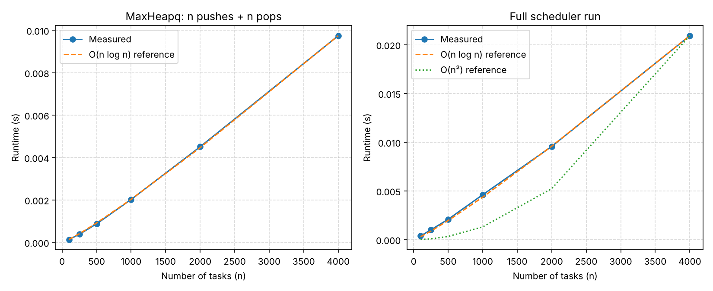

# Heap-Based Task Scheduler

A daily task scheduler that, at every step, picks the task with the highest **utility** using a custom max-heap priority queue. It respects task dependencies and fixed start times (e.g. "class starts at 6 PM").

Built for CS110 (Problem Solving with Data Structures and Algorithms) at Minerva University, as *Designing a Scheduler for a Day in the Life of a Minervan*, while I was living in Tokyo.



## How it works

Each task has a duration, dependencies, an importance and an enjoyment score, and optionally a deadline or an earliest start time. When a task becomes available, it is pushed into a max-heap keyed by its utility at the current time:

```
Utility = 0.4·U + 0.3·I + 0.2·D + 0.1·E
```

| Factor | Meaning | Score |
|---|---|---|
| **U** Urgency | How close the deadline is. `slack = deadline − now − duration`; less slack means more urgency. A fixed-time task becomes maximally urgent once its start time arrives. | 3 (no deadline / lots of slack) → 10 (no slack left) |
| **I** Importance | How critical the task is for health, grades and commitments | 1–10 |
| **D** Duration | Shorter tasks score higher: easier to fit in and rewarding to check off | 3 (2 h+) → 9 (<15 min) |
| **E** Enjoyment | How fun or pleasant the task is | 1–10 |

The scheduler then loops:

1. Push tasks that just became available into the priority queue.
2. Pop the highest-utility task, run it, and advance the clock.
3. Unlock tasks that depended on it.
4. If nothing is available, jump ahead to the next fixed start time. If there is none, report the tasks that can never run (circular or missing dependencies).

## Example: a day in Tokyo

```
$ python example_day.py
🕰 t=9h00   Morning exercise          (30 min)
🕰 t=9h30   Buying produce at 7/11    (25 min)
🕰 t=9h55   Study for class           (80 min)
🕰 t=11h15  Cook food                 (60 min)
⏭ No tasks ready; jumping from 12h15 to 18h00
🕰 t=18h00  CS110 at 6PM              (90 min)
🕰 t=19h30  Travel on train           (40 min)
🕰 t=20h10  Eat ramen                 (40 min)
🕰 t=20h50  Visit Senso-ji Temple     (40 min)
🕰 t=21h30  Go to Japanese karaoke    (120 min)
🏁 Completed all planned tasks in 14h30!
```

## Complexity

| Operation | Cost |
|---|---|
| `heappush` / `heappop` | O(log n) |
| Full scheduler run (n tasks, m dependency edges) | O((n + m) log n) |

The dependency graph is indexed once up front. Each task keeps a count of unfinished dependencies, so finishing a task only touches the tasks that depend on it. Tasks with a future start time wait in a second heap ordered by start time.

My first version rescanned every task after each step, which made a full run O(n²). The benchmark showed it: doubling the number of tasks roughly quadrupled the runtime (1.6 s at 4,000 tasks). The current version produces exactly the same schedules (checked on 400 random task sets) and runs 4,000 tasks in about 20 ms.

## Run it

```bash
pip install -r requirements.txt
python example_day.py      # the Tokyo day above
python -m pytest           # tests
python benchmark.py        # regenerates docs/scaling.png
```

## Project structure

```
scheduler/
  max_heap.py     # MaxHeapq: binary max-heap on a Python list
  scheduler.py    # Task (utility function) and TaskScheduler
example_day.py    # a day in the life of a Minervan in Tokyo
benchmark.py      # runtime scaling experiment
tests/            # heap correctness, dependency order, input-order invariance, cycles
```

## Limitations and next steps

- **Priorities are fixed once a task is queued.** Urgency changes as the clock moves, but a task's utility is computed only when it enters the queue. Recomputing it, or using a heap with `increase_key`, would let deadlines "catch up".
- **Separate queues for fixed and flexible tasks.** Rigid events and flexible tasks could live in their own priority queues and be merged when free time opens up.
- **Richer importance.** Split importance into health, academic and social sub-scores with their own weights.
- **Breaks and travel time.** Model transitions between tasks so the schedule is realistic.
